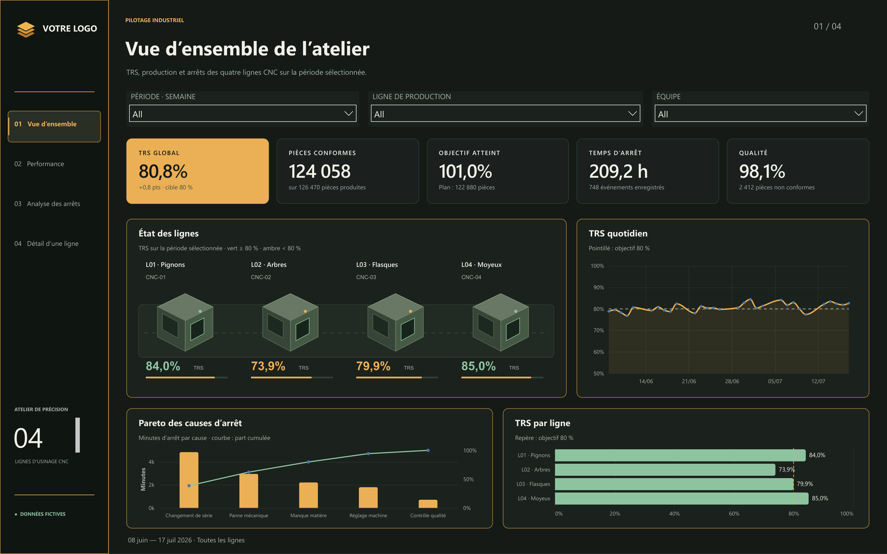
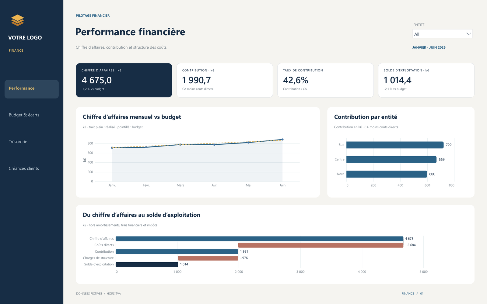
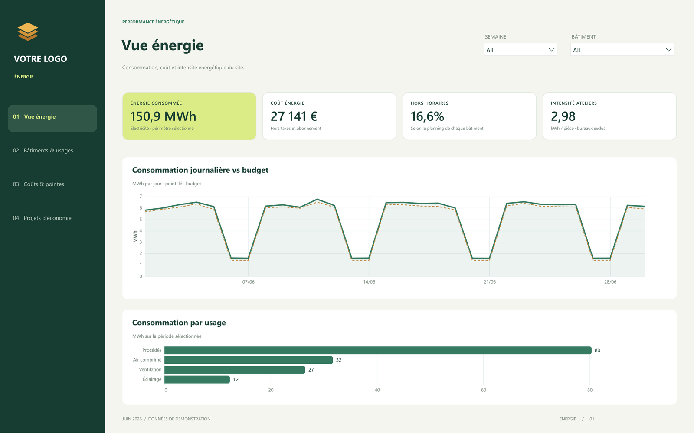
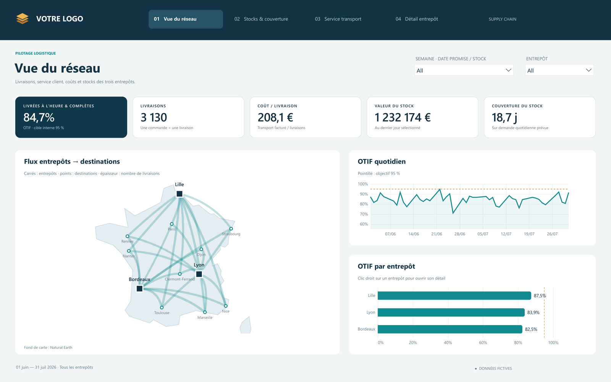
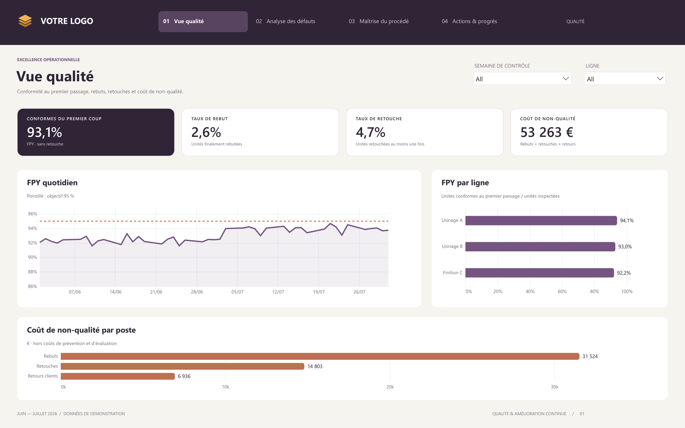
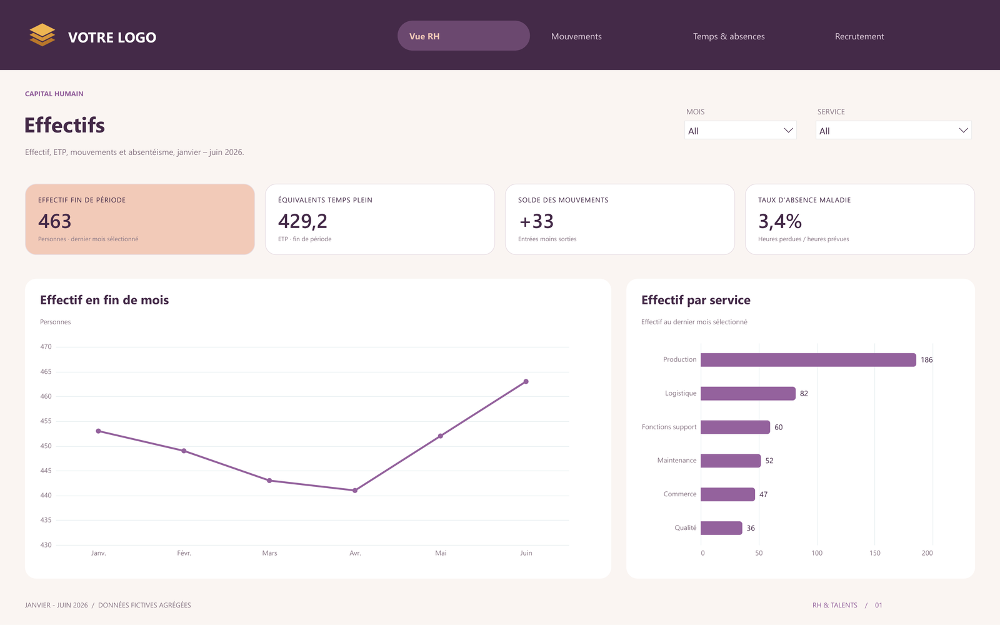
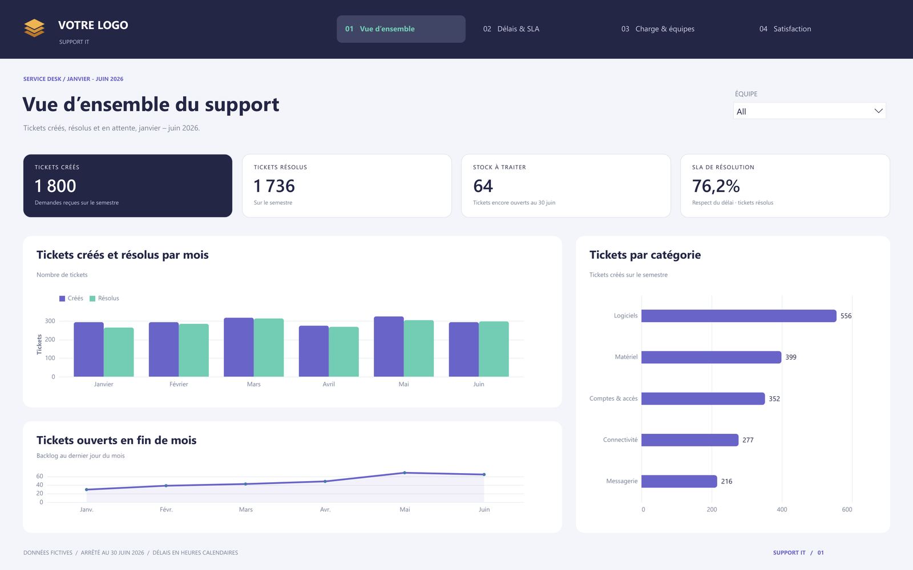
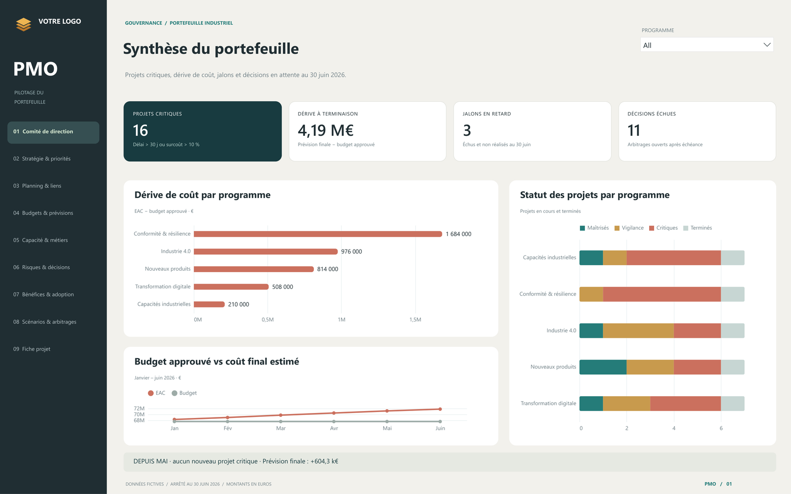

# Power BI dashboards

Eight Power BI reports on fictional data, one per business area. The reports are in French.

| Report | Pages | Content |
|---|---|---|
| [Industrie](industrie/) | 4 | OEE (TRS), planned-to-useful hours bridge, downtime Pareto, machine state timeline, drill-through to a single line |
| [Finance](finance/) | 4 | Revenue-to-operating-result bridge, revenue vs budget with monthly gap, variance by entity, cash bridge, receivables aging |
| [Énergie](energie/) | 4 | Daily consumption vs budget, use by building, hour × day heatmap, cost by tariff period, savings projects ranked by payback |
| [Logistique](logistique/) | 4 | OTIF, warehouse-to-destination map, stock cover by site and product family, carrier cost vs service |
| [Qualité](qualite/) | 4 | First pass yield, cost of poor quality, defect Pareto and location, X̄/R control charts with Cp/Cpk, action plan |
| [RH](rh/) | 4 | Headcount and FTE, joiners and leavers, sickness absence by team and month, recruitment funnel with step conversion, hire rate by source |
| [Support IT](support-it/) | 4 | Created vs resolved tickets, SLA by priority, share resolved over time by priority, backlog age, demand by weekday and hour, CSAT |
| [PMO](pmo/) | 9 | 40-project portfolio: cost drift, EVM (CPI, SPI, EAC), dependencies, capacity by role, risks, benefits, scenarios |

## Preview

**Industrie**

**Finance**

**Énergie**

**Logistique**

**Qualité**

**RH**

**Support IT**

**PMO**

Every page of each report is in its `screenshots` folder.

## Opening a report

Open the `.pbix` file in Power BI Desktop. The data is inside the file, so there is nothing to connect.

Most charts use two custom visuals from AppSource, Deneb (Vega-Lite) and HTML Content. Power BI Desktop downloads them the first time the report opens, which needs an internet connection.

Slicer labels such as "All" follow the language of Power BI Desktop.

## Using your own data

Each table is loaded with Power Query. To plug in your own data, change the source step of each query (Excel, CSV, database) and keep the same column names. The measures and visuals then work unchanged. The "VOTRE LOGO" placeholder can be replaced from the image visual at the top left of each page.

## Data

All figures are fictional and were generated for these demos. They do not describe any real company, customer or person.
